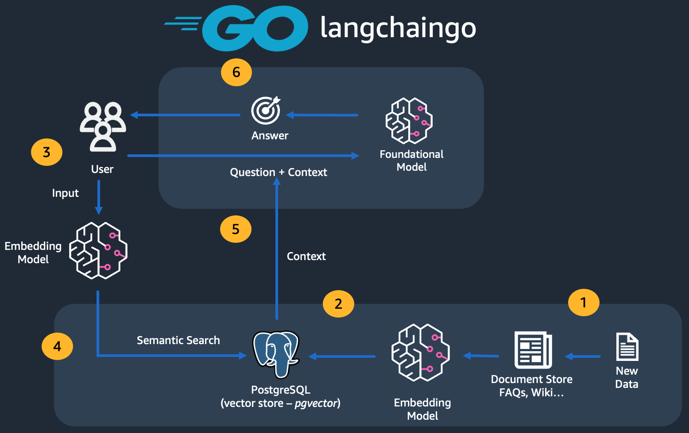

# Lab Insight Agent

An example of an AI agent written in Go for an insurance data analytics team
that supports underwriting. It answers questions by combining **SQL over
an underwriting portfolio** with **retrieval over reference documents (RAG)**.

The stack runs locally and for free:

- **Ollama** serves models `qwen3.5:9b` for chat and `nomic-embed-text` for embeddings.
- **Postgres DB + pgvector** stores the underwriting portfolio data and embeddings.
- **Temporal** provides the agent loop (durable alternative to LangGraph).
- Tools are exposed over **MCP** (Model Context Protocol).

## Data Sources

All data sourced is publically available and listed in
[`data/sources.json`](data/sources.json). The agent ingests this data with the
`make import` command.

## Local Deployment

```sh
make env               # creates .env from .env.example
make up                # Postgres, Ollama (NVIDIA GPU req), Temporal, Temporal UI
make run               # API on :8000 + Temporal worker; apply schema
make import            # in separate terminal; download sources, load portfolio, embed documents

make ask               # ask default question
make ask Q="How does claim frequency vary by bonus-malus level?"
make search Q="price walking ban" # retrieval only, no LLM

make eval              # run golden question set
```

## Agent Run Example

Take the following question: *"Which driver age and has the highest claim frequency?"*

1. The model reads the question and the tool descriptions, which include the
   table's columns and the two metric formulas.
2. Decides to call `query_portfolio.db` and writes SQL such as
   `SELECT CASE WHEN driver_age <= 25 THEN '18-25' ELSE '26+' END AS band, SUM(claim_count) / SUM(exposure) FROM policies GROUP BY 1.`
3. The SQL runs in a read-only transaction. The result table goes back to the
   model and a SQL error also goes back so the model can fix its query.
4. The model writes the answer (18-25 year olds claim about `0.175` per year,
   nearly double the rest), and the grounding check confirms every number
   came from a tool result.

For a question about the Irish market, the model calls `search_docs` instead, which looks
up passages in the Central Bank of Ireland PDFs and cites the file. A question that
compares both uses both tools in one run.

Open the Temporal UI at [`http://localhost:8080`](http://localhost:8080).

- An `import-`
  workflow shows each download, the load and the child ingest workflow.
- An `ask-`
  workflow shows every model call and tool call, including any grounding entry.

## MCP

```sh
make build
claude mcp add golabagent -- "$(pwd)/bin/golabagent" -mcp -env "$(pwd)/.env"
```

Then ask Claude code: *"Use golabagent to compare claim frequency for diesel and petrol vehicles."*

## Architecture Inspiration


[`https://github.com/build-on-aws/rag-golang-postgresql-langchain`](https://github.com/build-on-aws/rag-golang-postgresql-langchain)
